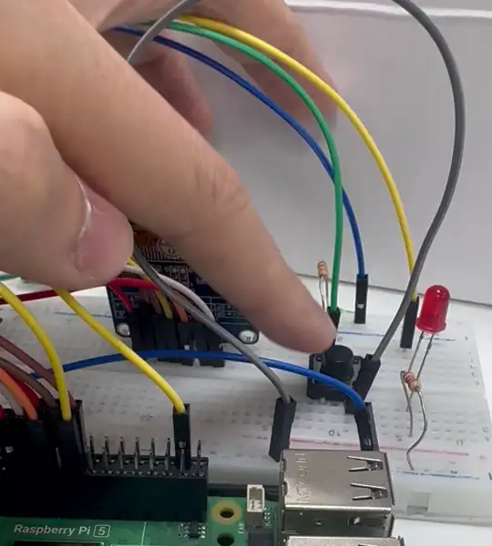
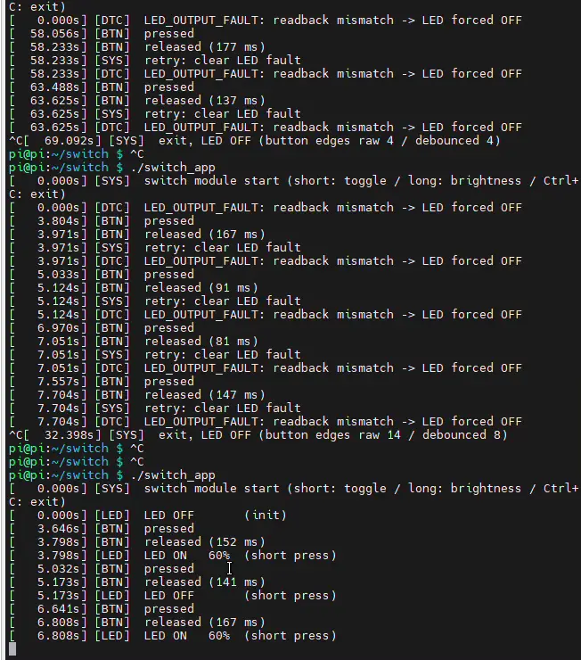

# Raspberry Pi 5 GPIO Register Driver

Raspberry Pi 5의 GPIO 컨트롤러(RP1) 레지스터를 공식 GPIO 드라이버 없이 `ioremap`으로 직접 다루는 리눅스 커널 드라이버를 만들고, 그 위에 미들웨어 API와 "버튼 LED 밝기 스위치 모듈" 앱을 올린 실습이다.

<p align="center">
  
</p>

<p align="center"><em>짧게 누르면 ON/OFF, 길게 누르면 밝기가 20 → 100 % 단계로 바뀐다 (Raspberry Pi 5 실기)</em></p>

- 드라이버: `/dev/ssafy_gpio` 캐릭터 디바이스. ioctl로 핀 모드, 출력, 입력, PWM, 진단을 제공하고 핀 번호와 모드를 검증한다.
- 미들웨어: `ssafy_gpio_pinMode()`, `ssafy_gpio_output()`, `ssafy_gpio_pwm()`처럼 비트 연산 없이 쓰는 API와 에러 코드, 버튼 디바운스.
- 앱: 짧게 누르면 ON/OFF, 길게 누르면 밝기 단계 변경, 5초 넘게 누르면 버튼 고착(`BUTTON_STUCK`) 보고.
- 진단: 출력 핀의 실제 레벨을 다시 읽어 명령값과 다르면 LED를 강제로 끄고(`LED_OUTPUT_FAULT`), 앱 종료나 `rmmod` 때도 출력을 끈다(fail-safe).
- 확인: Raspberry Pi 5 실기에서 API 자동 점검 23/23 PASS (고장 주입 포함), 스위치 앱 짧게/길게/고착 동작 확인.

| 항목 | 내용 |
|---|---|
| 과정 | SSAFY 16기 임베디드 트랙, 리눅스 커널 프로그래밍 (2026.11) |
| 인원 | 1명 |
| 사용 기술 | C, Linux kernel module, ioremap / MMIO, ioctl, hrtimer, RP1 GPIO |
| 실행 환경 | Raspberry Pi 5, 커널 `6.18.64-v8-16k+` |
| 포트폴리오 | [그 외 경험 · Raspberry Pi 5 GPIO 레지스터 드라이버](https://genius1998.github.io/embedded_portfolio/#others/rpi5-gpio-driver) |

---

## 프로젝트 배경

### 왜 공식 드라이버를 쓰지 않았나
리눅스에서 Raspberry Pi 5의 GPIO는 원래 커널의 `pinctrl-rp1` 드라이버가 관리하고, 앱은 libgpiod나 gpiozero로 쓰면 된다. 디바운스와 PWM도 이미 그 안에 있다.

이 실습은 그 계층을 일부러 건너뛰었다. MCU 펌웨어처럼 데이터시트의 레지스터 주소와 비트 필드를 보고 핀을 직접 설정하는 연습을 리눅스 커널 안에서 해 보는 것이 목적이다. 실제 제품이라면 device tree와 `gpiod`, `gpio-keys`, `gpio-leds`, PWM 서브시스템을 써야 한다. 이 점은 [한계](#6-한계)에 정리했다.

### 차량 스위치 모듈처럼
과정 실습은 LED 켜기, 버튼 값 읽기, 타이머 점멸처럼 기능별로 따로 끝난다. 이것들을 하나로 묶어 차량 실내 스위치처럼 동작하게 만들었다. 짧게/길게 누름을 구분하고, 버튼이 눌린 채로 고착되거나 출력이 명령과 다르게 나오면 고장으로 보고하고 안전한 상태(LED OFF)로 간다.

---

## 1. 전체 구조

```
switch_app.c        짧게/길게/고착 판단, 상태 로그          ← ssafy_gpio API만 사용
      │
ssafy_gpio.c / .h   pinMode · output · input · pwm · diag, 에러 코드, 버튼 디바운스
      │  ioctl (_IOW / _IOWR, copy_from_user · copy_to_user)
/dev/ssafy_gpio
      │
ssafy_gpio_drv.c    ioremap(RP1), 핀 검증, hrtimer PWM, readback 진단, fail-safe
      │  readl / writel
RP1 io_bank0 (GPIOn_CTRL · GPIOn_STATUS) + pads_bank0
```

| 파일 | 내용 |
|---|---|
| `ssafy_gpio_ioctl.h` | 커널과 앱이 같이 쓰는 ioctl 번호와 구조체 |
| `ssafy_gpio_drv.c` | 커널 모듈 |
| `ssafy_gpio.h`, `ssafy_gpio.c` | 미들웨어 API |
| `switch_app.c` | 버튼 LED 밝기 스위치 앱 |
| `api_test.c` | API 자동 점검 (PASS/FAIL 출력) |
| `Makefile` | 드라이버와 앱을 같이 빌드 |

---

## 2. 회로와 레지스터

| 장치 | 연결 | BCM | 물리 핀 |
|---|---|---|---|
| LED (+) | 출력 | GPIO 20 | 38 |
| LED (−) | 220Ω → GND | GND | - |
| 버튼 | 입력, 10kΩ → 3.3V 풀업, 반대쪽 GND (누르면 0) | GPIO 2 | 3 |

| 항목 | 값 |
|---|---|
| RP1 주변장치 base | `0x1f_0000_0000` (64MB `ioremap`) |
| io_bank0 / pads_bank0 | base + `0xd0000` / base + `0xf0000` |
| GPIOn_STATUS / GPIOn_CTRL | io_bank0 + `n*8` / `n*8 + 4` (GPIO20_CTRL = `0x1f000d00a4`) |
| PAD GPIOn | pads_bank0 + `0x04 + n*4` (GPIO20 = `0x54`, GPIO2 = `0x0c`) |
| CTRL 비트 | FUNCSEL `4:0`, OUTOVER `13:12` (0x2 LOW · 0x3 HIGH), OEOVER `15:14` (0x2 끔 · 0x3 켬), INOVER `17:16` |
| STATUS 비트 | `23` EVENT_LEVEL_HIGH (핀 레벨) |
| PAD 비트 | `7` OD, `6` IE, `5:4` DRIVE (0x1 = 4mA) |

출력 핀도 PAD의 IE(입력 허용)를 켜 둔다. 그래야 출력 중인 핀의 실제 레벨을 STATUS 23번 비트로 다시 읽을 수 있고, 이것이 readback 진단의 근거가 된다.

---

## 3. 동작

| 입력 / 상황 | 결과 |
|---|---|
| 짧게 누름 (< 0.7초) | LED ON / OFF 토글 |
| 길게 누름 (≥ 0.7초) | 0.4초마다 밝기 20 → 40 → 60 → 80 → 100 → 20 % |
| 계속 누름 (≥ 5초) | `[DTC] BUTTON_STUCK`, 뗄 때까지 입력 무시, 떼면 해제 |
| 출력 readback 불일치 | `[DTC] LED_OUTPUT_FAULT`, 드라이버가 LED 강제 OFF 후 fault 래치, 짧게 누르면 해제 후 재시도 |
| Ctrl+C, 앱 강제 종료 | 드라이버 `release()`에서 모든 출력 LOW |
| `rmmod` | 모든 출력 LOW 후 언로드 |

### 진단과 fail-safe를 어디에 두었나

| 기능 | 위치 | 이유 |
|---|---|---|
| 핀 번호 · 모드 · 값 검증 | 드라이버 + 미들웨어 | 앱이 잘못 불러도 레지스터까지 가지 않게 |
| 출력 readback | 드라이버 | 명령 직후(정적 출력), PWM의 매 edge, 주기 진단 호출 때 검사 |
| fault 시 LED OFF | 드라이버 | 앱이 멈춰 있어도 출력이 꺼지도록 |
| 디바운스 | 미들웨어 | 앱마다 다시 만들지 않도록 |
| 짧게/길게/고착 판단 | 앱 | 제품마다 달라지는 정책이라서 |

고장 상황은 모듈 파라미터 `inject_fault`로 만든다. 켜면 출력 핀의 readback 값을 뒤집어 "핀이 GND나 3.3V에 단락된" 상황을 흉내 낸다.

---

## 4. 검증 결과 (Raspberry Pi 5 실기)

### API 자동 점검 `sudo ./api_test`

| 구분 | 확인한 것 | 결과 |
|---|---|---|
| 입력 검증 | open 전 호출 → `-1`, 핀 1 · 28 → `-2`, 모드 5 → `-4` | PASS |
| 모드 위반 | 입력 핀(2)에 출력 → `-3`, 레벨 7 · duty 150 → `-4` | PASS |
| 출력 readback | HIGH 후 다시 읽으면 1, LOW 후 0 | PASS |
| PWM | duty 50% 설정, 0.5초 동안 fault 없음, 0%로 OFF | PASS |
| 버튼 | 안 누른 상태 1 (풀업) | PASS |
| 고장 주입 | 주입 중 HIGH → `-5`, LED 강제 OFF, 주입을 꺼도 fault 래치 유지, `clearFault` 후 복구 | PASS |

```
[PASS] output before open                         -> -1
[PASS] pinMode(1)  out of range                   -> -2
...
[PASS] [inject] output(20, HIGH) -> FAULT         -> -5
[PASS] [inject] LED forced OFF (actual 0)         -> 0
[PASS] [inject] fault latched                     -> -5
[PASS] [inject] clearFault                        -> 0
[PASS] [inject] output(20, HIGH) recovers         -> 0

result: 23 passed, 0 failed
```

### 스위치 앱 `./switch_app`

<p align="center">
  
</p>

<p align="center"><em>버튼 조작에 따라 MobaXterm에 찍히는 switch_app 로그</em></p>

전체 영상: [브레드보드 동작](results/hw_screen.mp4) · [터미널 로그](results/mobaxterm_screen.mp4)

```
[   0.000s] [SYS]  switch module start (short: toggle / long: brightness / Ctrl+C: exit)
[   0.000s] [LED]  LED OFF       (init)
[   4.534s] [BTN]  pressed
[   4.630s] [BTN]  released (96 ms)
[   4.630s] [LED]  LED ON   60%  (short press)
[  11.119s] [BTN]  pressed
[  11.823s] [LED]  LED ON   80%  (long press)
[  12.228s] [LED]  LED ON  100%  (long press)
[  12.632s] [LED]  LED ON   20%  (long press)
  ... (0.4초마다 한 단계)
[  15.841s] [LED]  LED ON   80%  (long press)
[  16.119s] [DTC]  BUTTON_STUCK: held > 5000 ms -> input ignored until release
[  17.035s] [BTN]  released (5916 ms)
[  17.035s] [DTC]  BUTTON_STUCK cleared (button released)
```

- 96ms 짧은 누름은 토글로 처리되었다.
- 길게 누르면 0.7초 뒤부터 0.4초 간격(로그 간격 400~405ms)으로 밝기가 바뀌었다.
- 누른 지 5.0초(11.119s → 16.119s)에 고착을 보고했고, 뗄 때 길게 누름이나 토글로 잘못 처리되지 않았다.

---

## 5. 빌드와 실행

```bash
# 커널 헤더 확인 (없으면 sudo apt install linux-headers-rpi-2712)
ls /lib/modules/$(uname -r)/build

make                                   # ssafy_gpio_drv.ko, switch_app, api_test
sudo insmod ssafy_gpio_drv.ko
sudo chmod 666 /dev/ssafy_gpio
sudo dmesg -w                          # 다른 터미널에서 커널 로그 보기

sudo ./api_test                        # 자동 점검 (sudo면 고장 주입까지)
./switch_app help                      # API 설명
./switch_app                           # 스위치 모듈 실행

# 실행 중 고장 주입 / 해제
echo 1 | sudo tee /sys/module/ssafy_gpio_drv/parameters/inject_fault
echo 0 | sudo tee /sys/module/ssafy_gpio_drv/parameters/inject_fault

sudo rmmod ssafy_gpio_drv
```

GPIO20, GPIO2를 쓰는 다른 모듈이 올라가 있으면 먼저 내려야 한다.

### 미들웨어 API

| 함수 | 설명 |
|---|---|
| `ssafy_gpio_open()` / `ssafy_gpio_close()` | 장치 열기 / 닫기 (닫으면 모든 출력 OFF) |
| `ssafy_gpio_pinMode(pin, INPUT \| OUTPUT)` | 핀 모드 설정 (GPIO2~27만 허용) |
| `ssafy_gpio_output(pin, LOW \| HIGH)` | 출력 + readback 검사 |
| `ssafy_gpio_input(pin)` | 핀 레벨 0/1 |
| `ssafy_gpio_pwm(pin, duty)` | 소프트웨어 PWM 100Hz, duty 0~100 |
| `ssafy_gpio_diag(pin, &diag)` | 명령값, 실제값, duty, fault, 불일치 횟수 |
| `ssafy_gpio_clearFault(pin)` | fault 래치 해제 |
| `ssafy_button_init()` / `ssafy_button_update()` | 버튼 디바운스 (기본 30ms) |

반환값: `0` 이상 성공, `-1` NOT_OPEN, `-2` PIN, `-3` MODE, `-4` VALUE, `-5` FAULT, `-6` BUSY, `-7` IO

---

## 6. 한계

- **공식 드라이버 우회**: `pinctrl-rp1`이 관리하는 레지스터를 직접 쓰므로 같은 핀을 다른 드라이버가 쓰면 충돌한다. 레지스터 제어를 익히기 위한 선택이고, 제품이라면 device tree와 `gpiod` / `gpio-keys` / `gpio-leds` / PWM 서브시스템을 쓴다.
- **readback으로 못 잡는 고장**: STATUS 23번 비트는 핀(pad) 레벨이라 단락은 잡지만, LED 선이 빠진 단선(open load)은 핀 레벨이 그대로라 잡지 못한다. 단선은 전류 센싱이 있어야 한다. 그래서 고장 시험은 `inject_fault`로 단락을 흉내 냈다.
- **소프트웨어 PWM**: hrtimer 콜백에서 핀을 토글하므로 지터가 있고 CPU를 조금 쓴다. PWM 채널도 1개다(다른 핀은 `-6` BUSY). RP1의 하드웨어 PWM을 쓰면 해결된다.
- **폴링 입력**: 버튼은 5ms 주기로 읽는다. 인터럽트(GPIO IRQ)로 바꾸지는 않았다.

---

## 7. 배운 점

1. 레지스터 주소를 계산식으로: 과정 실습에서는 GPIO20, GPIO2의 오프셋을 하나씩 찾아 썼다. 표를 다시 보니 STATUS는 `n*8`, CTRL은 `n*8+4`, PAD는 `0x04+n*4`로 규칙이 있어서, 핀 번호만 받으면 어떤 핀이든 설정하는 함수로 일반화할 수 있었다.
2. 출력도 다시 읽을 수 있다: 출력 핀이라도 PAD의 입력 허용(IE)을 켜면 실제 핀 레벨을 읽을 수 있다. "명령한 값"과 "실제로 나온 값"을 비교하는 것이 진단의 출발점이라는 것을 직접 구현하며 알게 되었다.
3. 안전 동작은 아래 계층에: 앱이 멈추거나 강제 종료되어도 LED가 꺼지려면 fail-safe를 앱이 아니라 드라이버의 `release()`와 fault 처리에 넣어야 했다. 계층마다 맡을 일(검증, 진단, 디바운스, 정책)을 나눠 보니 미들웨어가 왜 필요한지도 분명해졌다.
